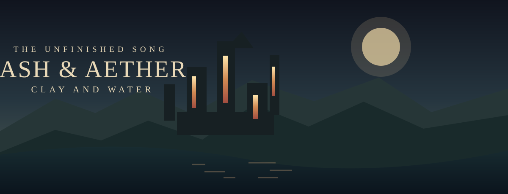

# Ash & Aether: Clay and Water

**Seven lives. One unfinished song.** A cinematic fantasy adventure about the memories of a city, the secrets beneath its water, and the places that change when you return.

> **The city burns its memories. The water remembers yours.**

**[Enter the original game](https://ash-aether-clay-water.towre676.chatgpt.site/)** · **[Visit the public showcase](https://towre676-cloud.github.io/Aether-Ash-game-source/)** · **[Explore the standalone Living World lab](https://towre676-cloud.github.io/Aether-Ash-game-source/labs/living-world.html)**

## What visitors can explore

The original game is hosted as [Ash & Aether: Clay and Water](https://ash-aether-clay-water.towre676.chatgpt.site/), separately from GitHub. Depending on its access settings, the original game may require a ChatGPT login.

This repository also includes a **real, offline-capable interactive laboratory**: [`labs/living-world.html`](labs/living-world.html), sourced from a recovered A&A ecology-reconciliation build. It contains functioning controls for walking, trampling, harvesting, fire, water, time progression, New Game+, and local save import/export. This is **a standalone subsystem test**, not a substitute for the full campaign or a claim that all lab features were merged into the live site.

### Explore the world

| The adventure | The development work |
| --- | --- |
| **ASH — The stolen song** | Spatial storytelling and traversal |
| **WATER — The undercity well** | Ecology, water and ground response |
| **AETHER — The sky engine** | Machines, environmental puzzles and dungeon layouts |
| **CLAY — Orchard after fire** | Persistence, change and recovery |
| **Seven lives. One unfinished song.** | Inventory, encounters, effects and adaptive audio |

The original game's opening and act names are drawn from the active site. Individual development branches are documented separately, without claiming that archived prototypes are production features.

## Quick start

**Play the main game:** Open [the game site](https://ash-aether-clay-water.towre676.chatgpt.site/). This repository does not contain an export of its complete v5.42+ runtime.

**Play the self-contained lab locally:** download [`labs/living-world.html`](labs/living-world.html) and open it in a modern browser; no server or dependency installation is required. JavaScript is needed for the lab, but not for this project's information pages.

**Run the site locally:** clone the repository and serve its root with `python -m http.server 8000`, then open `http://localhost:8000/`. The public showcase is also static HTML with no build step.

**Run the simple link/content checks:** `node scripts/check-site.mjs` (Node 18+).

## What's here

| Path | Description |
| --- | --- |
| [`index.html`](index.html) | Accessible, responsive, cinematic public project homepage |
| [`assets/cover.svg`](assets/cover.svg) | Original illustrative cover graphic (not a gameplay screenshot) |
| [`labs/living-world.html`](labs/living-world.html) | Self-contained standalone ecology/vegetation laboratory |
| [`docs/GAME.md`](docs/GAME.md) | Story, systems and playing notes |
| [`docs/DEVELOPMENT.md`](docs/DEVELOPMENT.md) | Development strands and integration checkpoints |
| [`docs/ACCESSIBILITY.md`](docs/ACCESSIBILITY.md) | Keyboard, reduced-motion and accessibility limitations |
| [`docs/PROVENANCE.md`](docs/PROVENANCE.md) | What was recovered and the known publication boundaries |
| [`.github/workflows/`](.github/workflows) | Link checks and Pages deployment workflow |

## Trust and release status

- **Publicly accessible repository:** yes, including this source and the site documents.
- **Original game:** deployed to a separate ChatGPT Site. GitHub and that Site are not synchronized automatically.
- **Living World lab:** a recovered, independent experiment; archive provenance recorded in [docs/PROVENANCE.md](docs/PROVENANCE.md). It does not establish production integration.
- **Full game source:** **not yet mirrored** here. Additional archives exist but require deliberate source/version reconciliation before becoming a canonical game build.
- **GitHub Pages:** deployment is configured through Actions; the repository owner may need to choose **Settings → Pages → Source: GitHub Actions** before the public project site is live.

See [development status](docs/DEVELOPMENT.md) for the next honest integration milestones. This repository does not grant any license for third-party redistribution unless a license is subsequently added by the owner.
