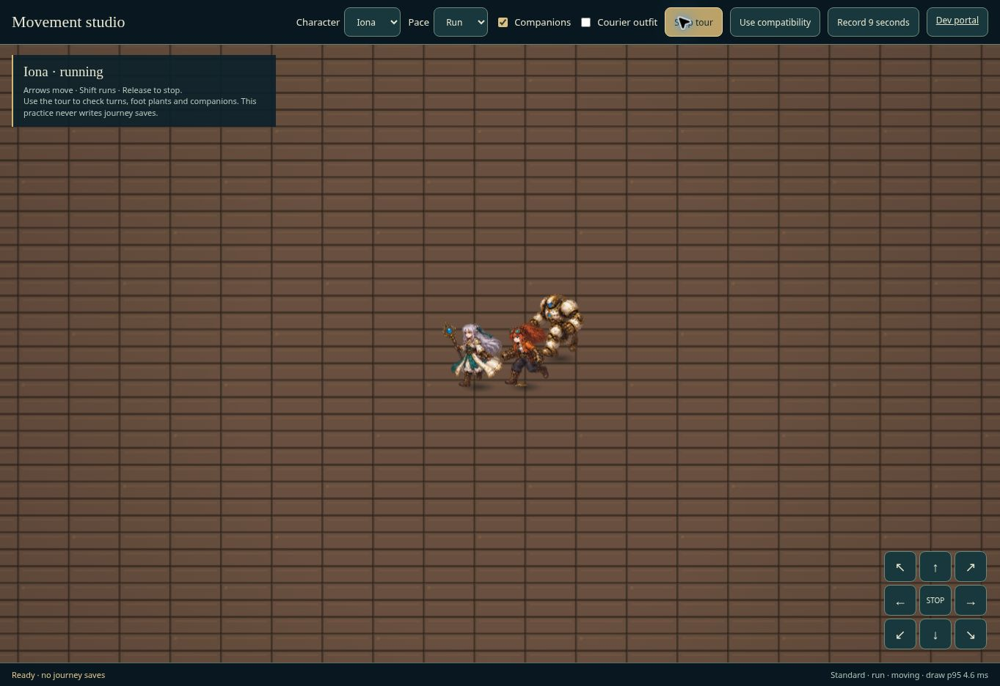

# Release 5.14: movement polish

Built on the completed 5.13 field-loop merge `2a5d40cf6b6904413fc995d909c3a263b506fa56`. The other session's visible creature packs, field opportunities, held/resumable guidance, expeditions and direct technique buttons are retained.

## Changes

- Both travel gaits use the coherent locomotion sheet. Distance advances the four-pose stride; walking and running have distinct cadence. Input intent turns a blocked character without animating running in place. Deliberate horizontal turns settle out of the rear view, and tiny follower drift does not flip facing.
- Offline torso/sole/body-height registrations cover all 128 poses in the three existing actor atlases. Compatibility mode shares the same measured registrations without requiring runtime pixel reads. Each sheet uses its own body-height registration so changing from idle to locomotion does not resize the actor. Source art and crop coordinates are unchanged.
- Manual movement starts, stops and reverses immediately, with normalized diagonals. Guided and tapped routes spend the whole frame's distance across exact path vertices, retain collision sweeps and stop after transitions. Ordinary routes preserve 5.13's 2.65 tiles/second exploration pace; running is 4.2. At 30, 60, 120 and 240 Hz the six-second route check travels 15.9 tiles.
- Companions begin on a verified local trail, then sample the leader's actual path. Exact corners, reversals, cramped starts, party changes and field/battle transitions avoid the previous spawn snap and high-refresh chatter. Rendering battle actors does not write their battle positions.
- Touch controls have radial and angular hysteresis; analog axes have separate engage/release thresholds. Cancellation releases held directions synchronously. D-pad input does not prime the analog deadband. There is no added momentum.
- Audio ambience caches settled profile, active and duck states. Sixty settled updates now make zero volume writes or pause calls, compared with 120 volume writes plus 60–120 pause calls previously. These are API call counts, not a measured frame-rate gain.
- The Movement studio uses the real renderer, actual sprites and production movement helpers. Character, pace, outfit, companions, graphics mode, eight-way tour, keyboard and hold controls are available. Its nine-second recording captures only the practice canvas. It never writes journey saves.
- Main-loop integration preserves held guidance and field encounter distance accounting; opening the action picker suppresses route movement and new field invitations. Quick technique labels show the actual calculated MP and optional HP cost.

## Verification

`node --test dist/game/engine2/tests/*.test.mjs`: **853 passed, zero failures/skips**, 157.4 seconds. This includes campaign, guidance, dev fixtures, combat, save, field-loop and motion coverage. The final studio-only keyboard-focus adjustment was syntax checked and exercised in browser after the suite; production game logic did not change afterwards.

`node development/art/measure-actor-anchors.mjs --check`: **128/128 measurements match**, bound to the three source-image SHA-256 values. Diff whitespace and changed JavaScript syntax checks pass.

Browser QA used the supported managed Chromium preview at 1363 × 936, not the user's laptop. Checked actual game launch, the developer chapter/guardian selector, guided field holds without deselection, Continue route into a guardian, direct Fault Rupture cast (Iona MP 50 → 41 and Rail Warden HP 572 → 448), and Mako picker with decision time paused in the fixed side console. No runtime error was reported by the canvas state. Motion tours and extracted contact sheets covered all seven heroes plus Sable's courier outfit across both graphics modes.

The full suite output is retained in [release-5.14-tests.log](release-5.14-tests.log).

Recorded actual-renderer samples:

- [Iona, Rook and Brass · standard · running](release-5.14-iona-motion.webm)
- [Riven, Mira and Veyr · compatibility · running](release-5.14-riven-motion.webm)
- [Sable courier, Iona and Rook · compatibility · walking](release-5.14-courier-motion.webm)

These clips show the motion implementation before the final 5.13 source merge; that merge retained the same sprite, stride and formation implementation. Final merged browser checks also passed. Canvas capture requests 60 fps; neither that request nor WebM metadata proves sustained 60 fps.

## Limits and reference

This pass improves the existing artwork; it does not add new drawn movement frames. The sheets have four locomotion poses per quarter view, with mirrored horizontal facing. Eight-way input does not mean eight independently drawn directions. Realistic gait could improve further with a richer authored animation set.

The exact PokeFable Online announcement was found on the creator's TibiaDevs profile, but no inspectable official gameplay or motion clip was available. No claim of a direct visual comparison or matched motion is made. An exact playable or video reference would allow that comparison later.

No Runway assets or credits were used. No new background artwork is included in this motion pass. Hardware Edge, phones, physical gamepads and sustained GPU/frame pacing need real-device checks. Browser tours and the automated refresh-rate checks do not establish device performance or subjective appeal.
